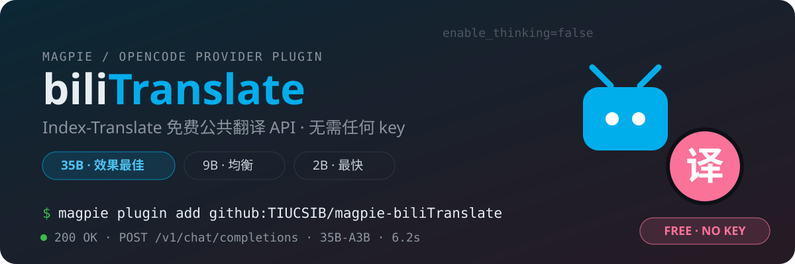

<div align="center">



[](https://usemagpie.ai/docs/zh/plugins)
[](https://opencode.ai/docs/plugins/)
[](https://github.com/bilibili/Index-Translate)

[](LICENSE)

**把 B 站 [Index-Translate](https://github.com/bilibili/Index-Translate) 免费公共翻译 API 接入
[magpie](https://usemagpie.ai) / [OpenCode](https://opencode.ai),成为所有智能体都能用的标准模型供应商。**

匿名可用 · 无需任何 key · 支持 22+ 语言(en / zh / ja / ko / de / fr / es / ru …)

</div>

## 模型

| 模型 id | 定位 | 上下文 | 输出 |
|---|---|---|---|
| `Index-Translate-35B-A3B` | 效果最佳(默认) | 16K | 4K |
| `Index-Translate-9B` | 均衡 | 16K | 4K |
| `Index-Translate-2B` | 最快 | 16K | 4K |

> 上游为免费公共服务:单次输入上限约 8000 字符,无官方用量承诺。

## 安装

**终端(GitHub 仓库直接加载):**

```sh
magpie plugin add github:TIUCSIB/magpie-biliTranslate   # 仓库就地加载
magpie plugin login bili-translate                      # 免费无 key,随便填,如 free
magpie provider test bili-translate                     # ✓ chat · Index-Translate-35B-A3B
```

**应用内:** 插件 → 添加插件 → 填入本仓库地址 → 在供应商行登录(随便填)。

完成后所有智能体即可使用 `bili-translate/Index-Translate-35B-A3B` 等三个模型,与内置供应商一致:多账号、故障切换、用量统计全部可用。

## 用法

模型按指令翻译,直接下指令即可。参考提示词模板(与 [官方脚本](https://github.com/bilibili/Index-Translate/blob/main/inference/llm/call_api.py) 一致):

**普通翻译**

```text
请将以下文本翻译为日语,直接输出翻译结果,不要进行任何解释。

<源文>
```

**结构化数据(只译 value,保留 JSON 语法)**

```text
【指令要求】严格保留合法 JSON 语法格式,仅翻译 value 文本
```

**术语约束**

```text
【术语干预】必须按照术语表翻译:碳纤维→carbon fiber
```

## 工作原理

```text
智能体请求(任意 API)
  → magpie 网关(协议转换为 chat completions)
  → 插件 fetch:注入 UA + chat_template_kwargs.enable_thinking=false
  → https://index-translate.bilibili.com/v1/chat/completions(匿名)
```

关键点:35B 等推理模型若开启思考,CoT 文本会顶掉正式译文。插件在每个请求上自动注入
`chat_template_kwargs: { "enable_thinking": false }`(用户显式设置的值会被保留)——
这正是官方 `call_api.py` 的 OpenAI 兼容桥接代理默认强制的行为。

## 行为说明

- 每个请求携带 UA `Index-Translate-Client/1.0 opencode-bili-translate/0.1.0`,与官方脚本一致
- 免费公共服务,插件默认 `maxConcurrency: 4`(可在供应商设置中调整)
- 无 `auth.usage` 钩子:免费服务无套餐概念;模型列表静态声明(上游无公开的动态 /models 列表)

## 验证

```sh
node verify.mjs
# PROVIDER_OK  https://index-translate.bilibili.com/v1 | Index-Translate-35B-A3B, Index-Translate-9B, Index-Translate-2B
# BASEURL_OK   https://index-translate.bilibili.com/v1
# UA_OK        Index-Translate-Client/1.0 opencode-bili-translate/0.1.0
# THINKING_OK  {"enable_thinking":false}
```

## License

[MIT](LICENSE) · 上游 API 由 bilibili Index-Translate 项目提供
